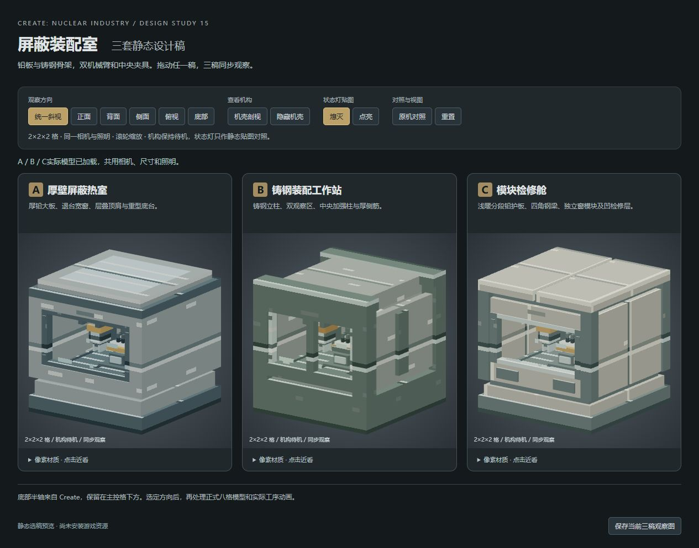

# 屏蔽装配室三稿选稿入口

2026-10-14最新反馈：用户明确选第三版C，按[反馈](ART-SHIELDED-ASSEMBLY-15A-FEEDBACK.md)接续[15B正式外观](tasks/ART-SHIELDED-ASSEMBLY-15B.md)。下文A推荐与待选文字为原交付时点，不推翻当前C选择。

2026-10-14，用户明确“开始吧”后，按[15A任务卡](tasks/ART-SHIELDED-ASSEMBLY-15A.md)完成三套静态设计稿。当前为选稿阶段，尚未选定或安装正式资源。

打开[实际模型预览](http://127.0.0.1:4193/)。三稿同步拖动/缩放，可切正面、背面、侧面、俯视、底部，或剖视/隐藏机壳查看机构。点亮/熄灭仅用于比较真实状态灯贴图；双机械臂和夹具保持待机，不模拟加工循环。

| 方向 | 主要区别 |
| :--- | :--- |
| A 厚壁屏蔽热室 | 厚铅大板、退台宽窗、层叠顶肩与重型底台；强调封闭屏蔽舱的重量感。 |
| B 铸钢装配工作站 | 铸钢立柱、双观察窗、中央加强柱和侧筋；偏机床结构。 |
| C 模块检修舱 | 浅暖分板、四角钢梁、独立窗模块和分片顶盖；检修分区清楚。 |

负责人倾向A的整机比例；此建议不等于用户已选A。三稿均保留现行2×2×2格与原机构枢轴，底部使用实际Create半轴，位于主控格下方而非整机中心。以真实配方的铅/钢为主，少量黄铜用于功能锁圈；图标色块不暗示新增接口或玩法。

## 来源与本批证据

新工具 `tools/art-assets/shielded-assembly-concepts-15/`：12个JSON、27张16² SVG、schema1来源契约，使用本地block-model-renderer2.20.0与既有Three0.180.0。SVG仅在浏览器内存解码为纹理，没有生成或安装正式PNG。

- [资产报告](reports/ART-SHIELDED-ASSEMBLY-15A-ASSETS.md)：最终有限检查passed=true、0错误，41个可消费来源身份、395个旧输入零变化；首轮和增强检查中间RED保留。
- [预览报告](reports/ART-SHIELDED-ASSEMBLY-15A-PREVIEW.md)：唯一68/68有限检查exit0、52个HTTP输入同源，Create底轴实际JAR/字节码/依赖来源保留。
- [负责人实看](reports/ART-SHIELDED-ASSEMBLY-15A-GPU/README.md)：最终reload后保存正常、正面点灯、剖视、底部、背面、俯视六图。重置后页面capture成功，本批build/reports下的preview目录保存browser-evidence ready=true/errors=[]、默认静态状态、三张latest图与输入SHA记录。
- [同次组合窄审](reports/ART-SHIELDED-ASSEMBLY-15A-REVIEW.md)：未发现静态设计稿必改；41资产/14预览来源零漂移、实际浏览45输入吻合原52HTTP身份。审查不代替用户选稿或游戏验收。

复用美术树 `codex/art-studio` / 88b8fd2，自有预览4193/PID18084保留供复看；原4191/4192保持。C盘满时将本批截图保存至E盘上述GPU目录，没有清理用户文件。已验离心机7d62147c…JAR、旧来源/日志/main/Git/世界/配置保持，无Gradle/Minecraft启动或打包。

下一步由用户选择方向或提出具体修改，再定义正式八格拆分/安装和基于实际同步工序的动画写集；网页观察不能代替Minecraft客户端验收。
