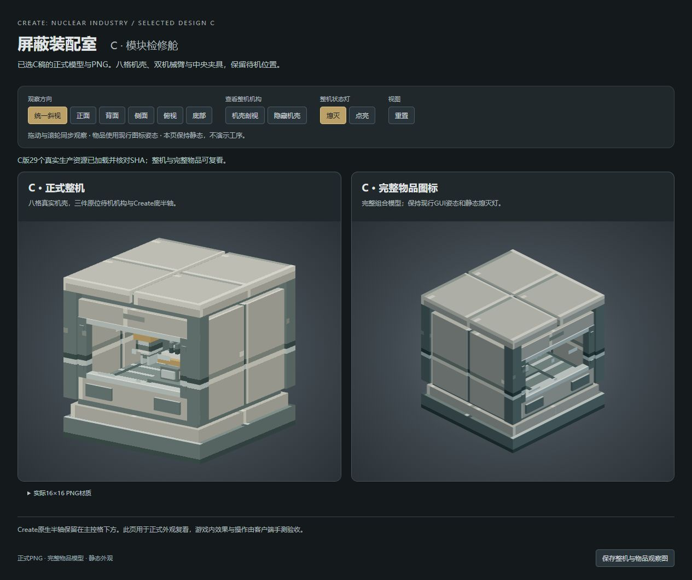

# C版屏蔽装配室外观候选

最新状态：2026-10-14用户对15B-R1黑窗修复明确“这次是对的了”，见[局部验收](ART-SHIELDED-ASSEMBLY-15B-R1-ACCEPTANCE.md)。本次观察窗黑面及内部机构被遮住的视觉门已关闭，当前修复包602985f8…保持；下文故障/待复看描述为原交付历史，其它未明确项目和工序动画不补记通过。

最新反馈：用户2026-10-14实际MC截图报告“中间是黑的”，本批游戏视觉未通过，见[反馈](ART-SHIELDED-ASSEMBLY-15B-FEEDBACK.md)。按[15B-R1卡](tasks/ART-SHIELDED-ASSEMBLY-15B-R1.md)局部定位/修复；下方a92包与自动/网页结论为故障基线，不能代替黑窗复看。

当前修复包已交[15B-R1入口](ART-SHIELDED-ASSEMBLY-15B-R1-CANDIDATE.md)，2,812,546B/602985f8…；只修8窗模型静态层声明、原生错误绑定8→0，同次审查及唯一增量构建/制品核通过，用户游戏局部门仍待。下文旧2,812,280B/a92为故障备份历史，不是当前build/libs包。

2026-10-14用户明确选第三版C「模块检修舱」，按[15B卡](tasks/ART-SHIELDED-ASSEMBLY-15B.md)实施正式八格机壳、完整物品与三待机partial。此候选当前仅外观，未增加机械臂/夹具工序动画；状态灯和底部原生动力轴沿原实现。

## 实际入口

- 工作树：`E:/MyMC/NewMod/Create_NuclearIndustry-art-studio`，分支`codex/art-studio`，基线88b8fd2。
- [正式PNG预览](http://127.0.0.1:4194/)：实际八格局部模型组成C整机、193元素完整物品；可看正面/剖视/底部与静态亮灭灯。4194/PID16460、exec托管session53337、Tab17保留。
- 29生产资源已安装并冻结：20JSON替换、9个15c新PNG；20旧模型备份、原7d完整JAR备份保留，旧PNG/旧单格兼容形态与Java未改。

## 已得证据与当前未完成项

[ASSETS](reports/ART-SHIELDED-ASSEMBLY-15B-ASSETS.md)：八块还原107外壳元素/UV与已选C精确一致、三partial29/29/28、物品归一化193元素并保现行display；九PNG逐像素/alpha同SVG。唯一0.6秒安装exit0，29/29源到生产SHA一致，106保护输入零变化。

[PREVIEW](reports/ART-SHIELDED-ASSEMBLY-15B-PREVIEW.md)：79/79、42HTTP输入同源。首轮物品相机看背底的问题由负责人真实发现，随后按真实库/MC字节码仅改预览相机+Z，原生产29资源不变；首轮证据保留，受影响scene语法/HTTP身份通过，没有机械重复79套。

[负责人实际浏览](reports/ART-SHIELDED-ASSEMBLY-15B-GPU/README.md)：最终production页reload后，正常/正面点灯/剖视/底部四图齐；完整物品前窗/顶盖可见，窗内机构可辨，底部原生半轴坐标保持。reset/capture明确成功，browser-evidence ready=true/errors=[]，35已加载输入、默认/off/static、工序动画false。

[单次组合审查](reports/ART-SHIELDED-ASSEMBLY-15B-REVIEW.md)及同次制品补核已实际交回，无剩余必改。65来源与29生产身份零漂移、修后GPU/GUI/旧页边界符合；原执行者唯一必要assemble已实际成功exit0/10.619秒，compileJava UP-TO-DATE、processResources/jar各执行一次。两作者和审查者已停写，不重复测试或构建，停本批用户Minecraft外观复看。

## 当前客户端包

使用本树 [create_nuclear_industry-0.1.0.jar](../../../../build/libs/create_nuclear_industry-0.1.0.jar)，2,812,280B，SHA256 `a92a0bed0f948fc000b58800cad34f84c03ffb314b167fea3a839f117b12ff7f`。root已独立GetFileHash读回。29候选/生产/processResources/JAR资源均同源，恰好20JSON替换/9PNG新增，0removed/0errors；557class保持，1926个非本批旧载荷保持。构建与身份见[CLIENT](reports/ART-SHIELDED-ASSEMBLY-15B-CLIENT.md)及本批client原始日志/核验JSON。

原2,815,098B/7d62147c…包完整备份至本批client/backup，旧d12/其它备份保留。最初C盘0，实际构建启动时已16.18GB，root随后读取约16.04GB；这不是本批清理结果。构建只在本次子进程用E盘临时目录，不改变全局环境或缓存位置。

服务两条Start-Process/重启命令曾被自动审批拒绝，完整命令/返回已保留；改用范围更窄的普通exec托管4194成功，旧4193不停止/重启。15A原机对照控件禁用并标旧模型存档；server源重定向尚未运行，不记生效。旧三稿/源码/图保留。本批截图存E盘，未清理已满C盘用户文件。

## 本批客户端复看

在本美术树启动`./gradlew.bat runClient`，或用上方当前包，由用户观察C机身/窗内静态机构/物品图标、完整八格接缝与朝向、既有状态灯及原底部轴。无需重测旧设备、配方/加工或管理员主线，工序动画不列本批通过项。网页与静态检查不代替Minecraft视觉验收。

main/Git/世界/配置/玩法与正式主目录JAR保持；没有合入、自动启动Minecraft、旧存档迁移或发布。
